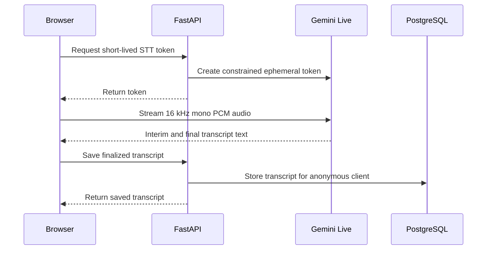

# Speech to Text

A monorepo for a real-time speech-to-text web app. Users can dictate in Hindi,
English, or a mix of the two, then review and manage their saved transcripts.
Text to Speech is intentionally out of scope: it appears once in the assignment,
while the rest of the requirements describe speech recognition.

For hosted setup, see [DEPLOYMENT.md](./DEPLOYMENT.md).

## Features

- Live microphone transcription with interim and final text.
- Automatic language detection or a Hindi + English mode.
- Save, search, paginate, edit, copy, and delete transcript history.
- Anonymous browser sessions; each visitor's records are scoped to a
  server-issued cookie.
- Database-backed quota of 10 recording-token and transcript-write requests
  per IP in a one-hour window that starts with the first request. The dashboard
  shows the remaining quota; only a keyed hash of the IP is stored.
- Security response headers, including anti-framing, MIME-sniffing, and
  microphone permission restrictions.
- Raw audio is streamed to Gemini Live and is not stored by this application.
- A local browser recovery draft helps recover transcript text if saving fails.

## Architecture



The browser captures and resamples microphone audio through an AudioWorklet.
It sends mono, 16 kHz PCM16 audio directly to Gemini Live using a short-lived
token issued by FastAPI. The Gemini API key stays on the server. UI components
depend on the `TranscriptionProvider` interface rather than a vendor SDK.

FastAPI routes delegate to services and repositories. SQLAlchemy 2 async handles
PostgreSQL access; Alembic manages schema migrations. FastAPI serves the built
React app and `/api` from the same origin when deployed.

The frontend uses React, TypeScript, Vite, Tailwind CSS, and TanStack Query.
Its shared visual theme is defined in `frontend/src/index.css`; components use
Tailwind utility classes rather than feature-specific CSS stylesheets.

The default model is `gemini-3.5-transcribe-live`, a dedicated transcription
model selected for this speech-recognition app. The browser only receives a
constrained ephemeral token. Each recording is capped at 10 minutes.

## Project layout

```text
backend/
  app/
    core/          Settings, anonymous identity, error handling
    db/            SQLAlchemy base and async session
    models/        SQLAlchemy ORM models
    repositories/  Database access
    routers/       FastAPI endpoints
    schemas/       Pydantic request and response models
    services/      Business logic and Gemini token creation
  alembic/         Database migrations
  tests/           Backend tests
frontend/
  src/
    config/        Shared UI copy, labels, and presentation settings
    features/      Recorder and transcription-history components
    providers/     Speech-provider interface and Gemini implementation
    api/           API client and generated OpenAPI types
    audio/         Microphone capture and PCM conversion
  public/          Static assets, including the PCM AudioWorklet
```

## Local development

### Requirements

- Python 3.12+
- [uv](https://docs.astral.sh/uv/)
- Node.js and npm
- Docker Compose
- A Gemini API key to use live recording

### Setup

1. From the repository root, copy the example environment file:

   ```powershell
   Copy-Item .env.example .env
   ```

   The example key is for local development only. Set `GEMINI_API_KEY` in
   `.env` to enable recording. Never commit `.env` or put the Gemini key in
   frontend configuration.

2. Start PostgreSQL:

   ```powershell
   docker compose up -d db
   ```

   Docker Compose publishes PostgreSQL on port `5435`. The local
   `DATABASE_URL` in `.env.example` already uses that port.

3. In a terminal, install backend dependencies, apply migrations, and start
   FastAPI:

   ```powershell
   Set-Location backend
   uv sync
   uv run alembic upgrade head
   uv run uvicorn app.main:app --reload
   ```

   The API is available at `http://localhost:8000`; its health endpoint is
   `http://localhost:8000/api/health`.

4. In a second terminal, install frontend dependencies and start Vite:

   ```powershell
   Set-Location frontend
   npm ci
   npm run dev
   ```

   Open the Vite URL shown in the terminal (normally
   `http://localhost:5173`). Vite proxies `/api` requests to FastAPI on port
   `8000`.

Microphone access requires HTTPS in hosted environments; localhost is allowed
for development by the browser.

## Tests and checks

Backend tests use a separate PostgreSQL database whose name must end in
`_test`. With the local Compose database running, create it once:

```powershell
docker compose exec db createdb -U speech speech_test
```

Then run backend tests and checks from `backend/`:

```powershell
uv run pytest
uv run ruff check .
uv run ruff format --check .
uv run mypy app
```

Run frontend tests and checks from `frontend/`:

```powershell
npm test
npm run typecheck
npm run lint
npm run build
```

Generate TypeScript API types from FastAPI's OpenAPI schema while the backend
is running:

```powershell
Set-Location frontend
npm run generate:api
```

## Environment variables

| Variable            | Purpose                                                                                      |
| ------------------- | -------------------------------------------------------------------------------------------- |
| `ENVIRONMENT`       | `development`, `test`, or `production`.                                                      |
| `APP_SECRET_KEY`    | Server-side signing key; use a private, strong value outside local development.              |
| `DATABASE_URL`      | PostgreSQL connection URL. Locally it uses asyncpg; Neon URLs are normalized by the backend. |
| `POSTGRES_USER`     | Local Docker Compose PostgreSQL username.                                                    |
| `POSTGRES_PASSWORD` | Local Docker Compose PostgreSQL password.                                                    |
| `POSTGRES_DB`       | Local Docker Compose database name.                                                          |
| `GEMINI_API_KEY`    | Server-only Gemini API key required for live recording.                                      |
| `GEMINI_LIVE_MODEL` | Live transcription model; defaults to `gemini-3.5-transcribe-live`.                          |

## Trade-offs and limitations

- Gemini Live is the implemented speech provider; a self-hosted speech engine
  is not included.
- Anonymous history is tied to the visitor's browser cookie. Clearing that
  cookie loses access to those records; there is no account-based recovery.
- Transcripts remain until deleted. The application does not retain raw audio.
- A Live API session ends after 10 minutes.
- The hosted free service may sleep when idle; see
  [DEPLOYMENT.md](./DEPLOYMENT.md) for deployment details and limitations.
